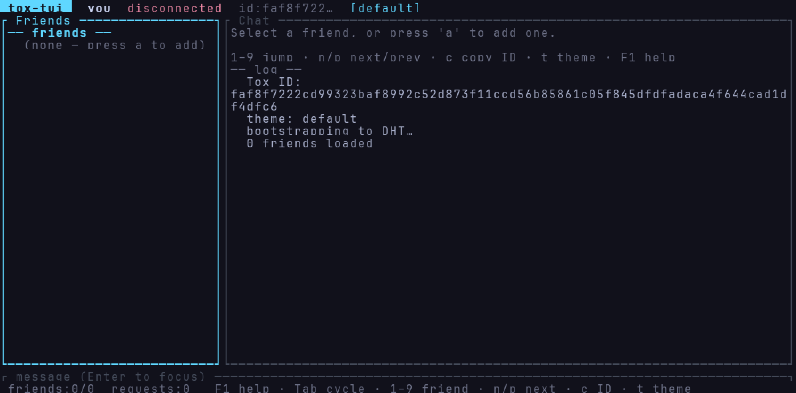
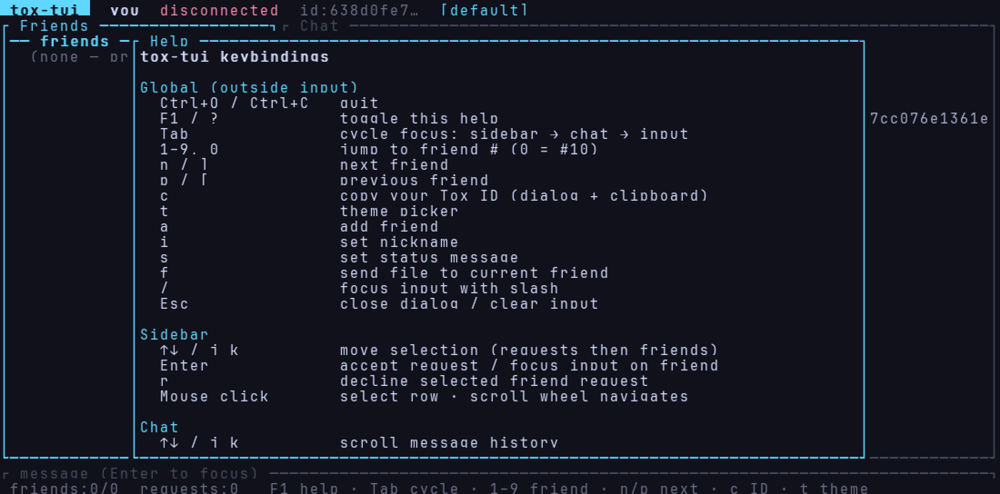
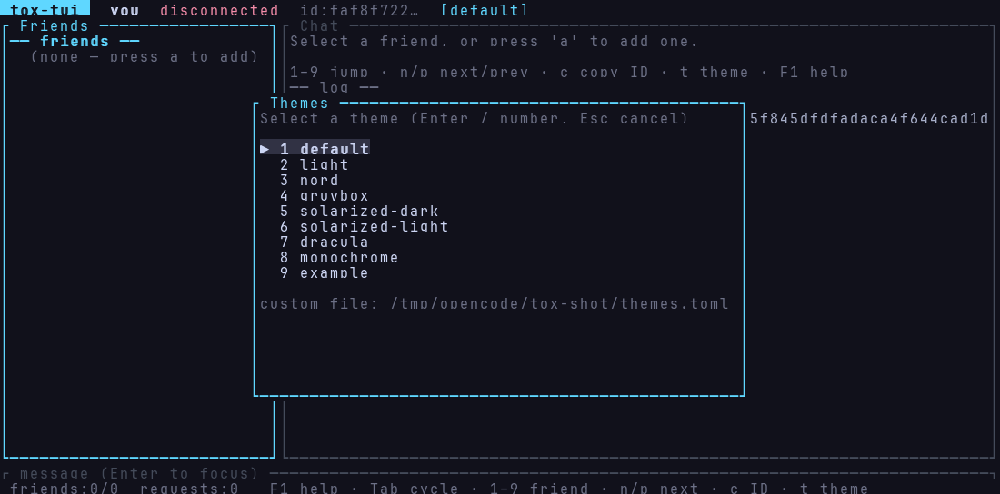
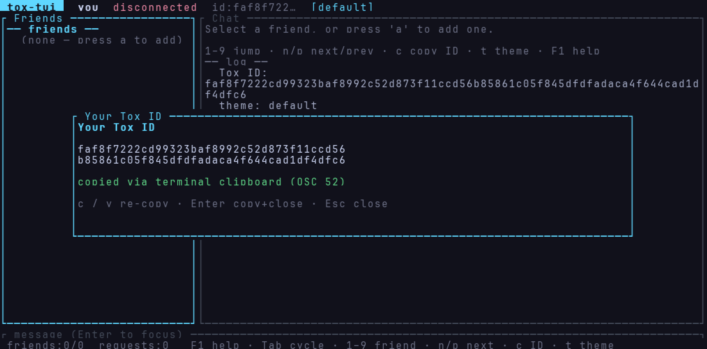
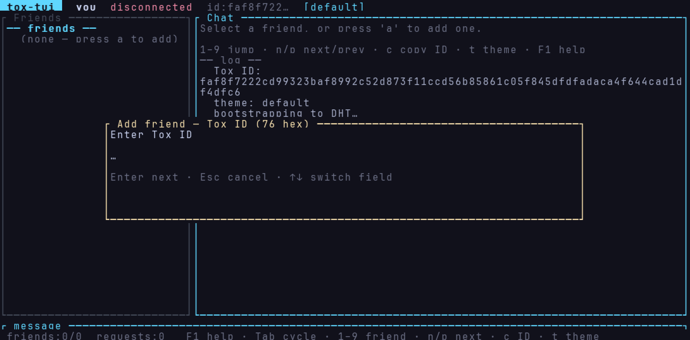
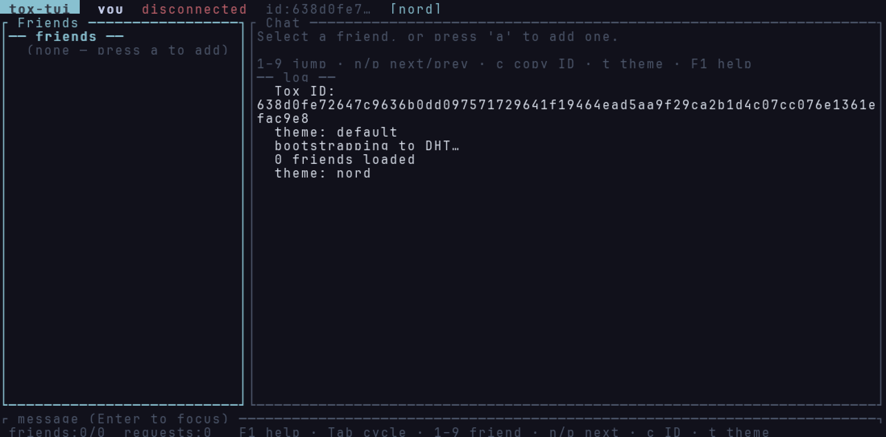
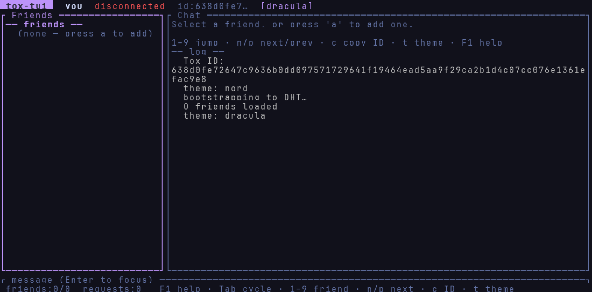

# tox-tui

a modern tox client that lives in your terminal :)



tox is peer-to-peer messaging with end-to-end encryption. no phone number, no
central server holding your chats. most of the old desktop clients (utox,
qtox) are basically abandoned, so this is a fresh one written in rust.

## install

needs the c-toxcore library + `pkg-config` (crypto lives there):

| distro | package |
|--------|---------|
| Debian / Ubuntu | `sudo apt install libtoxcore-dev pkg-config` |
| Fedora | `sudo dnf install c-toxcore-devel pkgconf-pkg-config` |
| openSUSE | `sudo zypper install c-toxcore-devel pkg-config` |
| Alpine | `apk add toxcore-dev pkgconf` |
| Arch | `sudo pacman -S c-toxcore pkgconf` |

then:

```bash
cargo install tox-tui
tox-tui
```

no package for your distro? build c-toxcore from source first (see [build](#build)).

## features

- identity that survives restarts (`tox.save` + `identity.json`)
- friend requests, presence, nicknames, status messages
- realtime chat with per-friend jsonl history on disk
- chunked file transfers with on-disk progress
- themes: default, light, nord, gruvbox, solarized dark/light, dracula,
  monochrome, plus custom palettes in `themes.toml`
- one key copies your tox id (osc 52, so it works over ssh)
- number keys jump to a friend, mouse click/scroll works too

## screenshots

| help (`F1`) | themes (`t`) |
|-------------|--------------|
|  |  |

| your id (`c`) | add friend (`a`) |
|---------------|------------------|
|  |  |

| nord | dracula |
|------|---------|
|  |  |

## crates

| path | role |
|------|------|
| `crates/tox-sys` | raw ffi to [c-toxcore](https://github.com/TokTok/c-toxcore) |
| `crates/tox-client` | async wrapper: identity, history, commands/events, transfers |
| `crates/tox-tui` | terminal ui (ratatui + crossterm) |

the pure-rust `tox` crate on crates.io stopped at 2020 and never grew a real
client api, so this talks to c-toxcore directly. crypto lives in c-toxcore;
the rust side just shuttles bytes.

```
ui thread (tokio + crossterm)          core thread (tox_iterate loop)
        │                                      │
        │── ToxCommand ──►  mpsc  ──►──────────┤
        │                                      │  tox_iterate(user_data)
        │◄── ToxEvent  ◄──  mpsc  ◄─── callbacks
        │                                      │
```

## build

you need rust stable (1.80+), cmake, a c compiler, and libsodium.

build c-toxcore into a local prefix first (no root needed):

```bash
git clone --depth 1 --branch v0.2.24 https://github.com/TokTok/c-toxcore.git vendor/c-toxcore
cd vendor/c-toxcore && git submodule update --init --recursive && cd ../..

cmake -S vendor/c-toxcore -B vendor/c-toxcore/build \
  -DCMAKE_BUILD_TYPE=Release \
  -DCMAKE_INSTALL_PREFIX=$PWD/local \
  -DBUILD_TOXAV=OFF -DUNITTEST=OFF -DAUTOTEST=OFF \
  -DBOOTSTRAP_DAEMON=OFF -DDHT_BOOTSTRAP=OFF

cmake --build vendor/c-toxcore/build -j$(nproc)
cmake --install vendor/c-toxcore/build
```

then the client:

```bash
cargo build --release
export LD_LIBRARY_PATH=$PWD/local/lib
./target/release/tox-tui
```

`TOXCORE_PREFIX=/path/to/prefix` points the build at a different c-toxcore
install.

## test

```bash
export LD_LIBRARY_PATH=$PWD/local/lib
cargo test
cargo clippy --all-targets -- -D warnings
```

the integration suite starts two tox instances, bootstraps them to each other
over loopback udp, and checks friend requests, chat, identity reload, and a
64 kib file transfer. no internet required.

release profile is already set up with thin lto, one codegen unit, and
symbols stripped. `cargo build --release` gives you a single ~2.7 mb binary.

## keys

| key | action |
|-----|--------|
| `Tab` / `←→` | cycle focus (sidebar, chat, input) |
| `↑↓` / `j k` | move selection / scroll chat |
| `1-9` / `0` | jump to friend #1-9 / #10 |
| `n` / `p` (or `]` / `[`) | next / previous friend |
| `Enter` | accept request, focus input, send message |
| `a` | add friend |
| `c` | show + copy your tox id |
| `t` | theme picker |
| `f` | send a file |
| `r` | decline a friend request |
| `i` | set nickname |
| `s` | set status message |
| `F1` / `?` | help |
| `Esc` | close dialog / clear input / leave input |
| `Ctrl+Q` / `Ctrl+C` | quit (saves identity) |

mouse: click sidebar rows, scroll the chat, click chat to focus it.

### slash commands

```
/add <ToxID> [greeting]   send a friend request
/file <path>              send a file to the current friend
/me <text>                action message
/name <nick>              set nickname
/status <text>            set status message
/id                       show your tox id (dialog)
/copy                     copy your tox id
/theme [name]             list themes or apply one
/themes                   same as /theme
/clear                    clear visible chat (history on disk kept)
/help                     keybinding help
/quit                     exit
```

## config

| env var | meaning |
|---------|---------|
| `TOX_TUI_DATA_DIR` | state directory (default `~/.local/share/tox-tui`) |
| `TOX_TUI_NAME` | nickname on first run |
| `TOX_TUI_STATUS` | status message on first run |
| `TOXCORE_PREFIX` | c-toxcore install prefix (build-time) |
| `RUST_LOG` | log filter on stderr, e.g. `tox_client=debug` |

on disk:

```
$TOX_TUI_DATA_DIR/
├── tox.save          # full tox savedata (keys, friends, ...)
├── identity.json     # human-readable address / public key
├── themes.toml       # custom theme palettes (seeded with an example)
└── history/
    └── <friend-pk>.jsonl
```

## license

GPL-3.0-or-later (same as c-toxcore).
